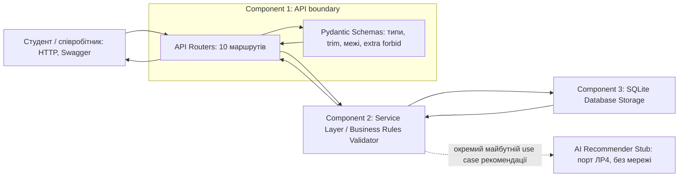
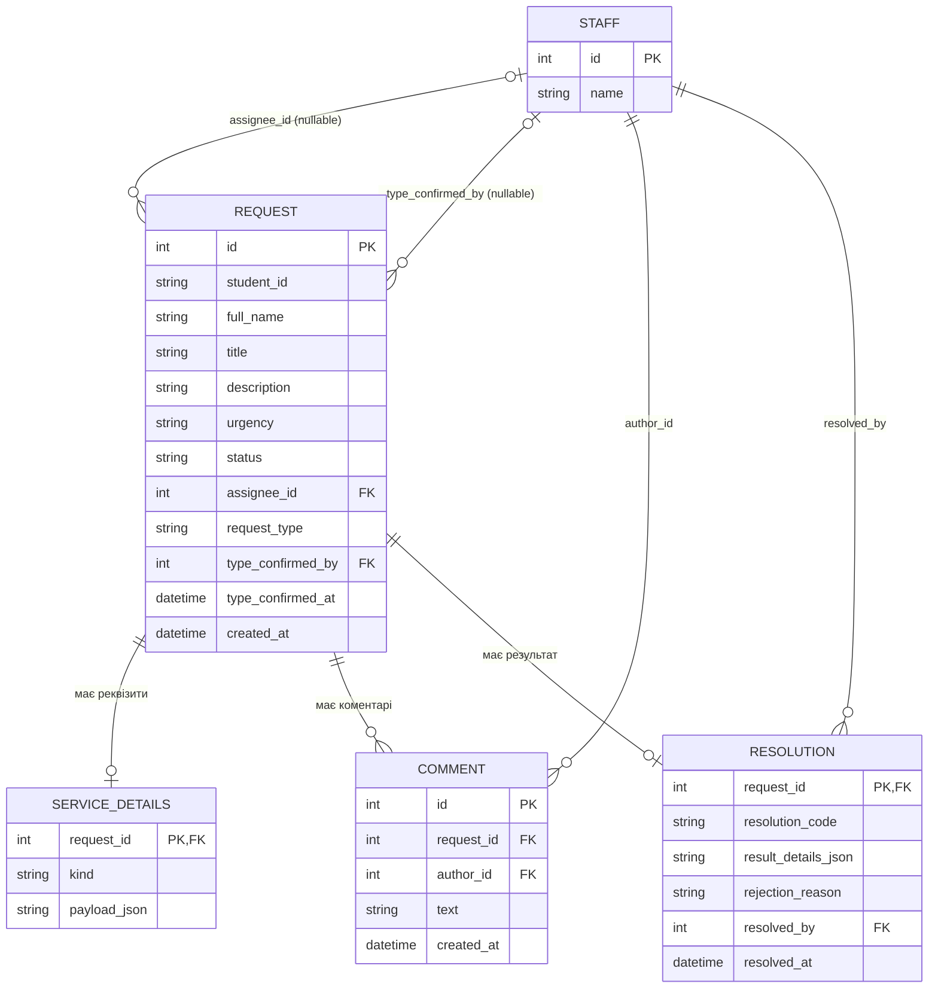

# ЛР01. Архітектура «Сервісу студентських звернень»

Бізнес-контракт: [requirements.md](requirements.md). Стек: Python 3.11+, FastAPI, Pydantic, SQLite, pytest. Архітектура є проєктом для ЛР2, не описом уже реалізованого застосунку.

## 1. Компоненти та відповідальність

Три основні компоненти: API boundary, Application Service, SQLite Storage. Усередині API boundary показано маршрутизатори та схеми; AI Stub є майбутнім адаптером порту. Така деталізація зберігає три основні відповідальності, визначені методичкою.

Routers: приймають path/query/body, викликають service, повертають коди з контракту, переводять RequestValidationError у єдину структуру 422. Не містять бізнес-переходів. Schemas: strict типи, нормалізація (trim), довжина, enum, дата, заборона зайвих полів та форма резолюції; PATCH зберігає набір явно переданих ключів. Service: пошук, AND-фільтрація, підтвердження, merged candidate, комплектність, 3×3 переходи, блокування заявника поза OPEN (D-11), типізований результат і його часові межі (D-12), ідемпотентність. Storage: FK, сортування, транзакції, відновлення даних із файлу; жодних мережевих залежностей. Stub: окремий об’єкт для точки розширення, ніколи не викликається основними CRUD-командами.

План структури ЛР2: app/main.py (composition root); app/api.py (маршрути); app/schemas.py (вхід/вихід); app/models.py (доменні value objects); app/service.py (use cases); app/database.py (SQLite та транзакції); app/repository.py (CRUD storage); app/ai_port.py (RecommendationProvider і stub); tests/conftest.py (тимчасова БД). Цей перелік не створює реалізації в ЛР1.

## 2. ER-модель

П’ять персистентних сутностей: Staff, Request, ServiceDetails, Comment, Resolution. CertificateDetails/CorrectionDetails — варіанти value object ServiceDetails; CertificateResult/CorrectionResult — варіанти value object результату Resolution. AIRecommendation — DTO майбутнього адаптера, у ЛР1 не зберігається.

ServiceDetails.kind відповідає одному із двох типів і може існувати до підтвердження request_type. payload_json зберігає лише поля відповідного value object, включаючи null для відсутніх даних. API повертає два іменовані nullable об’єкти, storage — один рядок із kind. Очищення об’єкта видаляє рядок; зміна типу замінює його в тій самій транзакції. Зв’язки STAFF → REQUEST мають кратність «нуль або один» з боку STAFF: assignee_id дорівнює null, доки виконавця не призначено або після зняття призначення (FR-05, AC-05-02); type_confirmed_by і type_confirmed_at дорівнюють null до підтвердження типу людиною (D-01). Зв’язки STAFF → COMMENT (author_id) і STAFF → RESOLUTION (resolved_by) обов’язкові, оскільки ці поля не допускають null.

## 3. Збереження та транзакції

Робочий шлях за замовчуванням data/student_requests.sqlite3, перевизначення через APP_DB_PATH. Директорія створюється при локальному запуску ЛР2; робоча БД та її WAL/SHM не включаються в Git. Кожен тест отримує окремий шлях у tmp_path. На кожному з’єднанні PRAGMA foreign_keys=ON. Staff 1/2 сідуються ідемпотентно. ID звернень/коментарів — INTEGER PRIMARY KEY AUTOINCREMENT. Час генерує UTC clock, для тестів він підміняється контрольованим clock.

Зміни відкривають BEGIN IMMEDIATE, перечитують поточний стан, повторно перевіряють допустимість операції для цього стану та весь кандидат, записують і виконують commit; помилка — rollback. Одночасне закриття та PATCH серіалізуються транзакцією, щоб не зберегти редагування після CLOSED. Зміна статусу та вставка Resolution виконуються в одній транзакції. Перевірки після merge належать service; CHECK/FK та унікальний request_id резолюції — захист storage, який не замінює доменну перевірку.

Сортування requests/comments: ORDER BY created_at ASC, id ASC. Час зберігається в одному UTC-форматі сталої точності, щоб лексикографічний порядок відповідав часовому. Не вводяться лічильник версії, Redis, черги чи distributed lock: масштаб — локальна навчальна БД.

## 4. ADR-01 — SQLite та локальне файлове збереження

**Статус:** прийнято у проєктній специфікації 10.10.2026; перевірка реалізації у ЛР2/ЛР3.

**Контекст:** потрібні persistence після перезапуску, транзакційний PATCH, два співробітники та невелика кількість синтетичних звернень. Стек замовника — FastAPI і SQLite.

**Варіанти:** пам’ять процесу (просто, але втрачає дані); JSON-файл (зберігає дані, проте складні FK, атомарні зв’язки та одночасні записи); SQLite (транзакції, FK, SQL без окремого сервера); PostgreSQL (надлишкові налаштування для локального обсягу).

**Рішення:** SQLite у локальному файлі, доступ лише через repository, service керує однією транзакцією на команду. JSON value objects у ServiceDetails/Resolution проходять Pydantic і бізнес-перевірку перед збереженням.

**Причина:** узгоджений стек, мінімальний запуск, підтримка збереження та атомарності.

**Наслідки:** один writer одночасно, придатність для навчального обсягу, відсутність серверної інфраструктури; правила вкладених JSON не забезпечуються лише SQL. APP_DB_PATH відділяє тести; файли БД не комітяться. Перевірки: AC-03-04, AC-07-04, NFR-01, NFR-03.

## 5. ADR-02 — ізольований ШІ та Human-in-the-loop

**Статус:** прийнято як точку розширення ЛР4, інтеграція моделі відкладена.

**Контекст:** рекомендація типу, urgency і summary має допомагати людині. Погоджені вимоги передбачають перевірку комплектності; доступність зовнішнього LLM не може визначати працездатність ядра.

**Варіанти:** синхронний виклик LLM у POST /requests (затримка та зовнішня залежність кожного створення); автоматичний запис типу/статусу з LLM (порушує людське підтвердження); ізольований RecommendationProvider із явним людським рішенням (ядро працює без моделі).

**Рішення:** порт recommend(request_snapshot) → AIRecommendation; реалізація stub у ЛР2 не викликає мережу та повертає ознаку недоступності рекомендації внутрішньому use case. У ЛР4 адаптер повертає валідовану рекомендацію або контрольовану помилку. Snapshot доступний лише для читання; provider не отримує repository або методів зміни. Поточні 10 маршрутів не викликають provider. Після людського підтвердження типу окремий use case ЛР4 передає адаптеру snapshot, підтверджений тип, каталог його обов’язкових полів і детермінований missing_fields; адаптер формує completeness_hint. Результат не підміняє перевірку service. Співробітник приймає чи змінює рекомендацію через звичайний PATCH із підтвердженням типу; gate комплектності — детермінована функція service.

**Причина:** зберігає Human-in-the-loop, відтворюваність тестів і автономність.

**Наслідки:** рекомендація сама не змінює тип, urgency, статус, реквізити чи резолюцію; неповне звернення лишається OPEN. Формат відповіді LLM перевіряється так само суворо, як інші DTO. Протокол публічного отримання рекомендації і стратегія timeout будуть узгоджені в ЛР4. AC-08-01..04, NFR-04 перевіряють ізоляцію. Відсутність LLM не змінює статус-коди поточного контракту.
